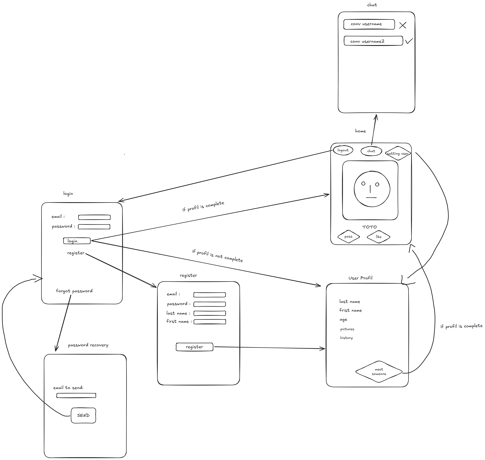
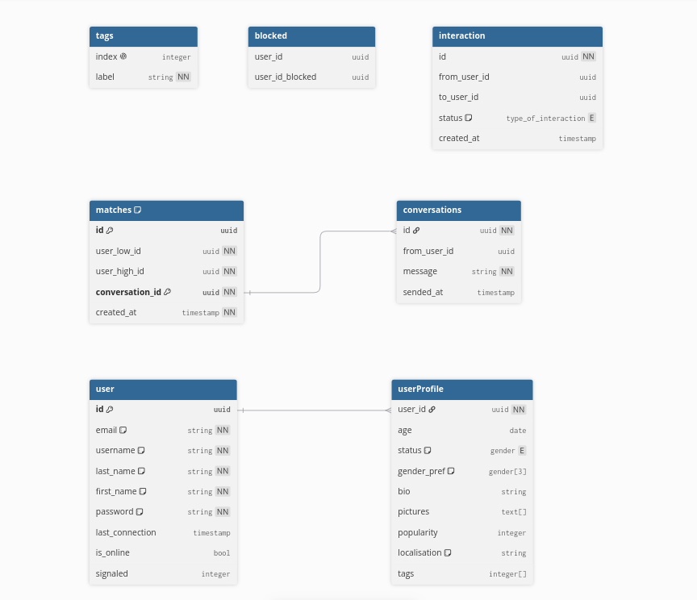

# Matcha

Ce projet vise à créer un site de rencontre.

les utilisateurs doivent pouvoir s’inscrire, se connecter, compléter leur profil, rechercher
et consulter les profils d’autres utilisateurs, et exprimer leur intérêt pour eux avec un
« like » Ils doivent également pouvoir discuter avec ceux qui ont réciproqué leur intérêt.

## Sommaire

1 - [Règles](#règles-à-respecter)

2 - [Inscription et connexion](#inscription-et-connexion) 

3- [Profil utilisateur](#profil-utilisateur)

## Règles à respecter

- Aucune erreur, warning ou notice ne doit être produite par l'Application.
- Aucune vulnérabilité de sécurité n’est autorisée.
- Libre choix du langage de programmation
- On peut se servir de bibliothèques d’interface (React, Angular, Vue, Bootstrap, Semantic, ou toute combinaison de celles-ci)
- la base de données doit contenir un minimum de 500 profils distincts.
- serveur web de notre choix 
- application entière doit être compatible avec au moins les dernières versions de Firefox et Chrome.
- les pages doivent avoir un en-tête, une section principale et un pied de page.
- Adaptable aux mobiles.

## Inscription et connexion

Après l’inscription, l’utilisateur doit recevoir un e-mail avec un lien unique pour vérifier
son compte

### Inscription

- adresse e-mail
- nom d’utilisateur
- nom de famille
- prénom
- mot de passe sécurisé

### Connexion

Tableau de connexion:
- nom d’utilisateur
- mot de passe

Lien de réinitialisation:
- adresse email.

Une fois connecté on a un bouton déconnexion.

### Profil utilisateur

Une fois connectés, les utilisateurs doivent compléter leur profil:

- **Genre**
- **Préférences sexuelles**
- **biographie**
- liste d’**intérêts** utilisant des tags (par exemple, #vegan, #geek, #piercing,etc.), qui doivent être réutilisables
- max **5 photos**, dont une désignée comme photo de profil.
- Les utilisateurs doivent pouvoir **modifier ces informations** à tout moment: leur nom de famille, prénom et adresse e-mail.
- **qui a consulté** leur profil.
- **qui les a « likés »**
- **note de popularité** publique.
- **localisation** via le positionnement GPS jusqu’à leur quartier, avec leur ***consentement explicite***. Il se limitera à la ville ou le code postal. Si un  utilisateur refuse le suivi de localisation GPS, ou manuellement une approximation (ville ou code postal) pour utiliser les fonctionnalités de matching. Cette saisie manuelle de la localisation est requise pour que l’application fonctionne correctement. Les utilisateurs doivent également avoir la possibilité de modifier leur localisation dans leur profil à tout moment.

## Navigation

Les utilisateurs ont accès à une liste de profils suggérés en fonction de leurs préférences:

- **Préférences sexuelles** (bisexuel par défaut)
- La **proximité** avec la localisation géographique de l’utilisateur.
- Le plus grand nombre de tags partagés.
- La « note de popularité » la plus élevée.
- La priorité doit être donnée aux utilisateurs de la même zone géographique.
-  **triage** par âge, ocalisation, « note de popularité » et tags communs.
- Les utilisateurs doivent pouvoir filtrer la liste en fonction de l’âge, de la localisation,
de la « note de popularité » et des tags communs.
- filtration.

## Recherche

Recherche avancé en fonction :
- Une tranche **d’âge** spécifique.
- Une plage de « note de **popularité** ».
- Une **localisation**.
- Un ou plusieurs **tags** d’intérêt.

## Consultation de profil

Les utilisateurs peuvent consulté les autres profils
toutes les informations sont disponibles à part l'<u>~~adresse mail~~</u> et bien sûre le <u>~~mdp~~</u>.

Enregistrer le profil visité dans l'historique du visiteur.

Lors d'une consultation: 
- **« Liker »** la photo de profil. Lorsque deux utilisateurs se « likent » mutuellement, ils seront considérés comme « connectés » et pourront commencer à discuter. 
- Si l’utilisateur n’a pas de photo de profil, il n'apparait pas dans la navigation et n'a pas accès au service.
- **Retirer un « like »** précédemment donné. Cela empêchera les notifications ultérieures de cet utilisateur, et la fonction de chat entre eux sera désactivée.
- Consulter la « note de popularité » d’un autre utilisateur.
- **actuellement en ligne** ou la date et l’heure de sa **dernière connexion**.
- **Signaler**([*](./postgreSQL/Catalog.md#signaled)) un utilisateur comme « faux compte », «scam» ou «problématique».
- **Bloquer un utilisateur**. Un utilisateur bloqué n’apparaîtra plus dans les résultats de recherche et ne générera plus de notifications. De plus, discuter avec lui ne sera plus possible.

Les utilisateurs doivent clairement voir si le profil qu’ils consultent les a **« likés »** ou s’ils sont déjà **« connectés »**. Ils doivent également avoir la possibilité de **« unliker »** ou de se déconnecter de ce profil.

## Chat
Lorsque deux utilisateurs sont connectés, ils peuvent clavarder en **temps réel** (**délai max 10s**).
- popup de notification depuis n'importe quelle page

## Notifications
Les utilisateurs doivent recevoir des notifications en temps réel(max 10s) sur n'importe quelle pages pour les événements suivants :
- Lorsqu’ils reçoivent un « **like** ».
- Lorsque leur profil a été **consulté**.
- Lorsqu’ils reçoivent un **message**.
- Lorsqu’un utilisateur qu’ils ont « **liké** » les « **like** » également **en** **retour**.
- Lorsqu’un utilisateur connecté les « unlike »

## Cybersécurité

vulnérabilités de sécurité qui ne sont pas tolérées :
- Stocker des mots de passe en clair dans votre base de données.
- Permettre l’injection de HTML ou JavaScript dans des variables non protégées.
- Permettre le téléchargement de contenu non autorisé.
- Permettre les attaques par injection SQL

## techno

### Fronts

#### pages

- register 
- login
- password recovery
- home
    - filter
    - picture
    - user name
- history
- setting

header or footer:
- deconnexion
- chat
- notification

### Back

### API

## Data Base Diagram

## Reférence
- [db diagram](https://dbdiagram.io): Pour la réflexion, création et représentation de la base de données.([code utilisé](./Ressources_README/db_diagram.txt))