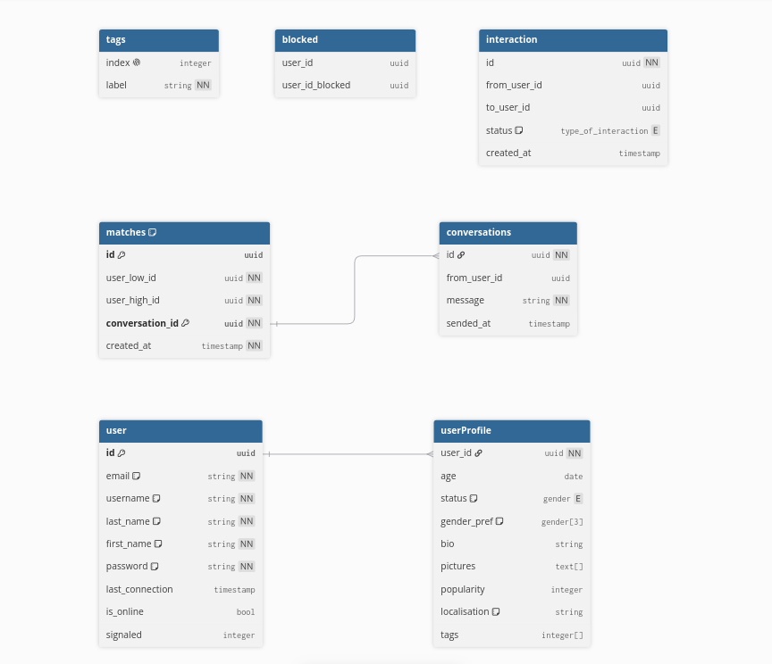

La base tourne sous PostgreSQL 16 (image `postgres:16-alpine`). Au premier démarrage du conteneur, `postgreSQL/init.sql` puis `postgreSQL/tags.sql` sont exécutés depuis `/docker-entrypoint-initdb.d/`.



## Types énumérés

| Type | Valeurs |
| --- | --- |
| `gender_type` | `Male`, `Female`, `Other` |
| `type_of_interaction` | `Liked`, `Viewed`, `Blocked`, `Reported`, `Unliked` |

## users

Comptes utilisateurs.

| Colonne | Type | Contraintes |
| --- | --- | --- |
| `id` | `UUID` | Clé primaire, `gen_random_uuid()` |
| `email` | `VARCHAR(255)` | Unique, non nul |
| `username` | `VARCHAR(50)` | Unique, non nul |
| `last_name` | `VARCHAR(100)` | Non nul |
| `first_name` | `VARCHAR(50)` | Non nul |
| `password` | `VARCHAR(255)` | Non nul, hash Werkzeug |
| `last_connection` | `DATE` |  |
| `is_online` | `BOOLEAN` | Défaut `false` |
| `signaled` | `INTEGER` | Défaut `0`, nombre de signalements |

## userProfile

Informations de profil, une ligne par utilisateur.

| Colonne | Type | Contraintes |
| --- | --- | --- |
| `user_id` | `UUID` | Unique, FK `fk_user` vers `users(id)`, `ON DELETE CASCADE` |
| `age` | `DATE` | Date de naissance |
| `gender` | `gender_type` | Défaut `Other` |
| `gender_pref` | `gender_type[]` | Défaut `{Male, Female}` |
| `bio` | `TEXT` |  |
| `picture_profile_index` | `INT` | Index de la photo de profil dans `pictures` |
| `popularity` | `INT` | Défaut `0` |
| `localisation` | `VARCHAR(255)` | Défaut `NULL` |
| `tags` | `INT[]` | Identifiants de `tags` |

## pictures

Photos des utilisateurs (5 maximum selon le cahier des charges).

| Colonne | Type | Contraintes |
| --- | --- | --- |
| `index` | `INT` | Non nul, position de la photo |
| `user_id` | `UUID` | Non nul, FK vers `users(id)`, `ON DELETE CASCADE` |
| `url` | `VARCHAR(255)` | Non nul, nom du fichier servi par [`/api/pictures`](/api/pictures) |

## interactions

Historique des actions entre utilisateurs.

| Colonne | Type | Contraintes |
| --- | --- | --- |
| `id` | `UUID` | Clé primaire |
| `from_user_id` | `UUID` | Non nul, FK `fk_from_user`, `ON DELETE CASCADE` |
| `to_user_id` | `UUID` | Non nul, FK `fk_to_user`, `ON DELETE CASCADE` |
| `which_interaction` | `type_of_interaction` | Non nul |
| `created_at` | `TIMESTAMP` | Défaut `CURRENT_TIMESTAMP` |

## matches

Paires d'utilisateurs qui se sont likés mutuellement.

| Colonne | Type | Contraintes |
| --- | --- | --- |
| `id` | `UUID` | Clé primaire |
| `user_low_id` | `UUID` | Non nul, FK `fk_low_user`, `ON DELETE CASCADE` |
| `user_high_id` | `UUID` | Non nul, FK `fk_high_user`, `ON DELETE CASCADE` |
| `created_at` | `TIMESTAMP` | Défaut `CURRENT_TIMESTAMP` |

La contrainte `unique_match_relation` sur `(user_low_id, user_high_id)` empêche les doublons. Le seed range toujours le plus petit identifiant dans `user_low_id`.

## chat

Messages échangés dans le cadre d'un match.

| Colonne | Type | Contraintes |
| --- | --- | --- |
| `id` | `UUID` | Non nul, FK `fk_chat_id` vers `matches(id)`, `ON DELETE CASCADE` |
| `from_user_id` | `UUID` | Non nul |
| `message` | `VARCHAR` |  |
| `sended_at` | `TIMESTAMP` | Défaut `CURRENT_TIMESTAMP` |
| `is_read` | `BOOLEAN` | Défaut `false` |

## blocked

Relations de blocage.

| Colonne | Type | Contraintes |
| --- | --- | --- |
| `user_id` | `UUID` | Non nul, FK `fk_user`, `ON DELETE CASCADE` |
| `user_id_blocked` | `UUID` | Non nul, FK `fk_user_blocked`, `ON DELETE CASCADE` |

La contrainte `unique_block_relation` sur `(user_id, user_id_blocked)` empêche les doublons. Les noms de contraintes sont utilisés par l'API pour renvoyer des codes d'erreur précis (voir [Blocage](/api/blocked)).

## tags

Tags d'intérêt réutilisables.

| Colonne | Type | Contraintes |
| --- | --- | --- |
| `id` | `SERIAL` | Clé primaire |
| `label` | `VARCHAR(25)` | Unique |

`tags.sql` insère une liste de tags prédéfinis (`vegan`, `geek`, `piercing`, `Jardinage`, `Cinéma`, `Lecture`, `Voyager`...).

## Accès depuis le backend

Le backend se connecte avec `psycopg` (`back-matcha/database/connection.py`). La connexion est stockée dans `flask.g`, utilise `dict_row` pour renvoyer les lignes sous forme de dictionnaires, et est fermée à la fin de chaque requête.

Pour ouvrir un shell dans le conteneur :

```bash
make postgres
psql -U $POSTGRES_USER -d $POSTGRES_DB
```
