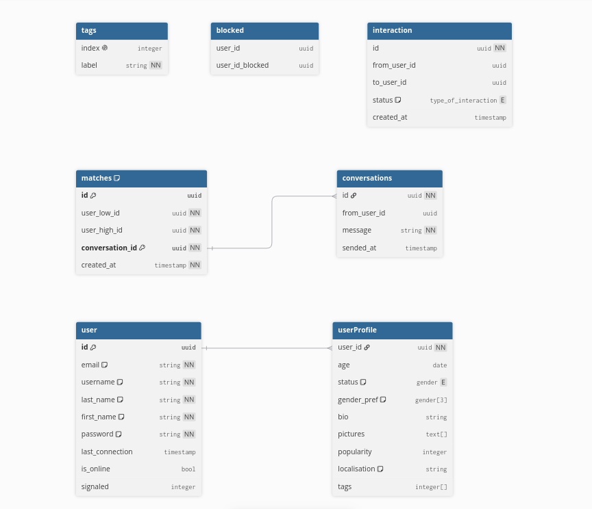

# Catalogue 

## Diagramme

## Dictionnaire

#### users table

###### id:
unique 

###### email:
- contient juste un @
- contient juste un . 
- max: 255 caractères

###### username:

- caractère autorisé: alphanumérique
- max: 50 caractères

###### last_name:

- caractère autorisé: alpha, ' ', '-'
- max: 100 caractères

###### first_name:
- caractère autorisé: alpha, ' ', '-'
- max: 50 caractères

###### password:
- 8 caractères min
- 1 Majuscule min
- 1 caractère spécial min
- 1 chiffre min
- ne doit pas être un mot courant
- ne doit pas contenir son nom ou prénom

###### last_connection:
- le jour de sa dernière connection

###### is_online:
- valeur booléenne si il est en ligne

###### signaled:
user(signaled): defaut à 0, si l'indicateur arrive à 5 le profil est supprimé.

----------------

### usersProfile table

###### user_id:
- lié à users(id)
- si users(id) est supprimé cela supprime le Profil

###### age:
- prend la date de naissance
- peut étre modifié
- incrémente avec l'année

###### gender:
- gender type Male, Female ou Other

###### gender_pref:
- attiré par Male, Female ou Other

###### bio:
- texte pour se présenter 

###### pictures:
- max 5
- min une pour utiliser l'application

###### popularity:
- plus les points sont élevé  plus populaire est le profil
- valeur à la création 0
- like = +1 point
- unlike = -1 point
- se faire bloquer = -5
- se faire signaler = -5

###### localisation
- 

###### tags

- int value en reference à tags(index)

------------

### interaction table

###### id:

###### from_user_id:
- id de qui a fait l'action

###### to_user_id:
- id sur qui a été affecté par l'action

###### which_interaction:
- peut être Liked, Viewed ou Matched 

###### created_at:
- date et heure quand l'intéraction est arrivé

------------

### matches table

###### id:
- id du match 

###### user_low_id:
- id de l'user qui est l'id la plus basse

###### user_high_id:
- id de l'user qui est l'id la plus haute

###### chat_id:
- référence de la conversation

###### created_at:
- date et heure quand le match a eu lieu

------------

### chat table

###### id:
- reference de la conversation
- si le match est supprimé ça supprime le clavardage

###### from_user_id:
- qui envoie le message

###### message:
- text

###### sended_at:
- à quelle heure est envoyé le message

###### is_read:
- defaut à false
- le message a bien été lu quand l'utisateur qui n'est pas le from_user_id ouvre la conversation

-----------

### blocked table

###### user_id:
- id de l'utilisateur qui veut bloquer

###### user_id_blocked:
- id de l'utilisateur qui est bloquer

----------

### tags table

###### id:
- index du tag auto increment

###### label:
- text
- max 25 caractères
- ne peut pas être en doublon
- fautes d'orthographe toléré
- ne peut être modifier ou supprimer par l'utilisateur